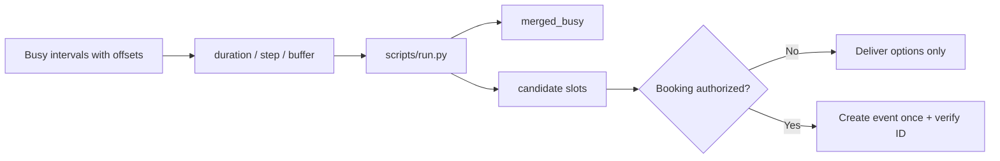

# Calendar Slots

[English](README.md) · [中文](README.zh-CN.md) · **v0.2.1**

[](https://github.com/KarmenLoop/skill-calendar-slots/releases/latest)
[](https://www.python.org/downloads/)
[](LICENSE)
[](skill.json)
[](SKILL.md)

**Find meeting-sized gaps across busy intervals—without connecting a calendar account or booking anything.**

Shared availability collapses when timezones are guessed and booking is mixed into discovery. **Calendar Slots** is a portable agent skill plus a local Python helper that merges concrete busy intervals (explicit UTC offsets required), applies duration / step / buffer, and returns candidate windows. There is **no calendar provider connection** and **no booking action**—returned times describe only the intervals you supplied.

Built and maintained by [KarmenLoop](https://github.com/KarmenLoop) / [KARMENLOOP](https://karmenloop.com). Current release: **[v0.2.1](https://github.com/KarmenLoop/skill-calendar-slots/releases/tag/v0.2.1)**. License: **MIT**.


*Actual local output from v0.2.1, rendered as an image. [Complete result](examples/expected.json) · [Image provenance](docs/images/provenance.json).*

[Download v0.2.1](https://github.com/KarmenLoop/skill-calendar-slots/releases/tag/v0.2.1) · [Tutorial](docs/tutorial.en.md) · [中文教程](docs/tutorial.zh-CN.md) · [Input contract](docs/INPUT.md)

---

## Why this exists

Agents often invent “free Thursday afternoon” from a city name. This package refuses that: offsets must be explicit; recurring expansion and timezone-database conversion are out of scope for the helper and must be done upstream if needed. Booking remains a separate, authorized step.

---

## Snapshot

| | |
|---|---|
| **What you install** | Portable skill (`SKILL.md`, docs, examples) + local helper under `scripts/` |
| **Package name** | `karmen-calendar-slots` |
| **Version** | **0.2.1** (`skill.json`, release tag, `--version`) |
| **Runtime** | Python **3.9+**, standard library only |
| **Network** | Helper: **offline** (`"network": false` in `skill.json`) |
| **Entry** | `python3 scripts/run.py --input …` · optional `python3 install.py --host agents` |
| **Sample artifact** | [examples/input.json](examples/input.json) → [examples/expected.json](examples/expected.json) |
| **License** | [MIT](LICENSE) — keep [NOTICE.md](NOTICE.md) with redistributed copies |

---

## Is / Is not

| Is | Is not |
|---|---|
| Offline slot finder over supplied busy intervals | Google / Outlook calendar connector |
| Duration, step, buffer, optional `max_slots` | Invitation sender or room booker |
| Explicit-offset timestamps only | Timezone guessed from location |
| Merged busy + candidate windows in JSON | Recurring-event expander (upstream) |
| Portable skill + stdlib helper | Always-on scheduling daemon |

---

## How it works

1. **Method layer** — fetch free/busy for named participants only; expand recurrence via the provider before helper input; present a few candidates in the user’s preferred display zone; book only if authorized.
2. **Helper** — pure interval math on concrete timestamps → `slots`, `merged_busy`, `truncated`.

### Flow



### Sample (v0.2.1)

Window **09:00–12:00 UTC** with **10:00–11:00** busy yields **four** 30-minute slots; `truncated` is false. See [examples/expected.json](examples/expected.json).

---

## Quickstart

### A. Run the helper (no agent host required)

1. Download `karmen-calendar-slots-v0.2.1.zip` and its `.sha256` from the [v0.2.1 release](https://github.com/KarmenLoop/skill-calendar-slots/releases/tag/v0.2.1).
2. Verify the hash, then extract.
3. In the extracted directory, with Python 3.9+:

```sh
python3 scripts/run.py --version
python3 scripts/run.py --input examples/input.json
```

Expected version string: `karmen-calendar-slots 0.2.1`. JSON lands on stdout. Use `--output new-result.json` to keep a copy without overwriting existing files. Pipe mode: `--input -`.

### B. Install the portable skill

For hosts that read `~/.agents/skills` (or a project `.agents/skills`):

```sh
python3 install.py --host agents
```

The installer **refuses an existing destination**—use a fresh path or remove the old copy first. Host discovery and invocation vary; see [docs/tutorial.en.md](docs/tutorial.en.md). You can keep using the helper directly without any AI host.

### Use it with your own work

- Give every timestamp an explicit UTC offset.
- Use `duration_minutes`, `step_minutes`, and `buffer_minutes` around busy intervals.
- Bound the candidate list with `max_slots` when presenting options to a human.
- Re-check current availability before any booking step.

Read [docs/INPUT.md](docs/INPUT.md) before preparing new input. The helper needs no model account, API key, or network connection. An AI host has its own data and permission settings; this skill adds no authority to send, purchase, publish, or change access.

---

## Documentation map

| Doc | Use it when you need… |
|---|---|
| [Tutorial (EN)](docs/tutorial.en.md) · [中文](docs/tutorial.zh-CN.md) | Download, install, practice, upgrade, remove |
| [INPUT.md](docs/INPUT.md) · [input.zh-CN.md](docs/input.zh-CN.md) | Field contract |
| [COMPATIBILITY.md](docs/COMPATIBILITY.md) | Host / runtime notes |
| [VALIDATION.md](docs/VALIDATION.md) | What checks cover |
| [SOURCES.md](docs/SOURCES.md) | Provenance pointers |
| [CHANGELOG.md](CHANGELOG.md) | History through 0.2.1 |
| [SECURITY.md](SECURITY.md) / [SUPPORT.md](SUPPORT.md) / [CONTRIBUTING.md](CONTRIBUTING.md) | Ops |

---

## FAQ

### What is Calendar Slots in one sentence?

A MIT-licensed agent skill and offline helper that finds meeting-sized free windows from concrete busy intervals—without connecting a calendar or booking.

### Does it read my Google Calendar?

No. You (or an upstream connector you authorize) supply busy intervals. This package never opens a calendar account.

### Will it send invites?

No. Delivering options and creating an event are separate. The skill adds no send authority.

### Why are naive local times rejected?

Guessing a zone from a city name is a common scheduling bug. Explicit offsets keep the math honest.

### Does the helper expand RRULE recurrences?

No. Expand with the calendar provider first, then pass concrete occurrences.

### Soft discoverability

Useful phrases: **find meeting slots from busy intervals**, **offline calendar availability skill**, **UTC-offset scheduling helper**, **buffer-aware free/busy math**. Avoid stuffing; the substance is in the skill and helper, not keyword density.

---

## License and contact

[MIT](LICENSE). Keep the license and [NOTICE.md](NOTICE.md) with redistributed copies.

Maintainer: [KarmenLoop](https://github.com/KarmenLoop) · Site: [karmenloop.com](https://karmenloop.com)

Issues: [GitHub Issues](https://github.com/KarmenLoop/skill-calendar-slots/issues) · Support policy: [SUPPORT.md](SUPPORT.md). Prefer synthetic data when filing example bugs.
