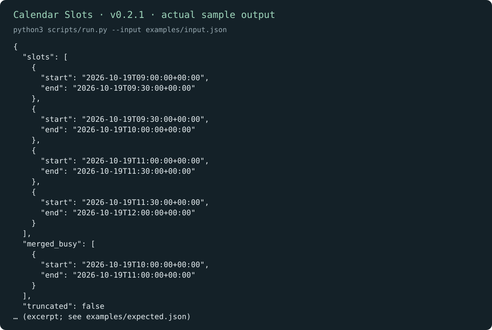
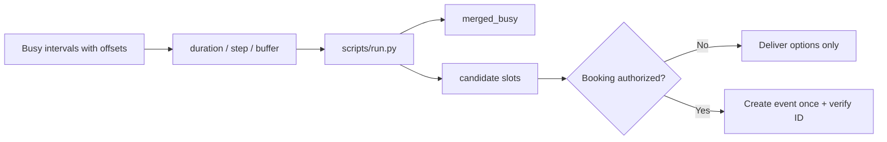

# 空闲时段 · Calendar Slots

[English](README.md) · [中文](README.zh-CN.md) · **v0.2.1**

[](https://github.com/KarmenLoop/skill-calendar-slots/releases/latest)
[](https://www.python.org/downloads/)
[](LICENSE)
[](skill.json)
[](SKILL.md)

**从忙碌区间里找出可开会的空档——不连接日历账号，也不预订会议。**

时区靠猜、发现与预订混在一起时，共同空闲就会失真。**空闲时段**是可移植的 Agent Skill，外加本地 Python 助手：合并具体的忙碌区间（必须带显式 UTC 偏移），按时长 / 步进 / 缓冲计算候选空档。**不连接日历服务，也不预订**——结果只反映你提供的区间。

由 [KarmenLoop](https://github.com/KarmenLoop) / [KARMENLOOP](https://karmenloop.com) 维护。当前发行版：**[v0.2.1](https://github.com/KarmenLoop/skill-calendar-slots/releases/tag/v0.2.1)**。许可：**MIT**。



*图片来自 v0.2.1 的真实本地输出（英文键名）。[完整结果](examples/expected.json) · [图片来源记录](docs/images/provenance.json)。*

[下载 v0.2.1](https://github.com/KarmenLoop/skill-calendar-slots/releases/tag/v0.2.1) · [中文教程](docs/tutorial.zh-CN.md) · [English tutorial](docs/tutorial.en.md) · [输入契约](docs/input.zh-CN.md)

---

## 为什么需要它

代理常会根据城市名臆造“周四下午有空”。本包拒绝这样做：偏移必须显式；循环日程展开与时区库换算不在助手范围内，需要时由上游完成。预订仍是另一步、需单独授权。

---

## 一览

| | |
|---|---|
| **安装内容** | 可移植 Skill（`SKILL.md`、文档、样例）+ `scripts/` 下本地助手 |
| **包名** | `karmen-calendar-slots` |
| **版本** | **0.2.1**（`skill.json`、发行标签、`--version`） |
| **运行时** | Python **3.9+**，仅标准库 |
| **网络** | 助手：**离线**（`skill.json` 中 `"network": false`） |
| **入口** | `python3 scripts/run.py --input …` · 可选 `python3 install.py --host agents` |
| **样例产物** | [examples/input.json](examples/input.json) → [examples/expected.json](examples/expected.json) |
| **许可** | [MIT](LICENSE) — 再分发时保留 [NOTICE.md](NOTICE.md) |

---

## 是 / 不是

| Is | Is not |
|---|---|
| 对你提供的忙碌区间做离线空档计算 | Google / Outlook 日历连接器 |
| 支持时长、步进、缓冲与可选 `max_slots` | 发邀请或订会议室 |
| 仅接受带显式偏移的时间戳 | 根据地点猜测时区 |
| 输出合并忙碌区间与候选空档 JSON | 循环日程展开器（需上游） |
| 可移植 Skill + 标准库助手 | 常驻调度守护进程 |

---

## 如何工作

1. **方法层** — 只拉取具名参与者在查询窗内的忙闲；循环日程先由日历服务展开再喂给助手；用用户偏好时区展示少量候选；仅在已授权时预订。
2. **助手** — 对具体时间戳做区间运算 → `slots`、`merged_busy`、`truncated`。

### 流程



### 样例（v0.2.1）

**09:00–12:00 UTC** 查询窗内有 **10:00–11:00** 忙碌，得到 **四个** 30 分钟空档；`truncated` 为 false。详见 [examples/expected.json](examples/expected.json)。

---

## 快速开始

### A. 直接跑助手（不需要 AI 宿主）

1. 从 [v0.2.1 发行页](https://github.com/KarmenLoop/skill-calendar-slots/releases/tag/v0.2.1) 下载 `karmen-calendar-slots-v0.2.1.zip` 与对应 `.sha256`。
2. 核对哈希后解压。
3. 在解压目录中使用 Python 3.9+：

```sh
python3 scripts/run.py --version
python3 scripts/run.py --input examples/input.json
```

期望版本字符串：`karmen-calendar-slots 0.2.1`。JSON 默认输出到 stdout。用 `--output new-result.json` 落盘且不覆盖已有文件。管道：`--input -`。

### B. 安装可移植 Skill

若宿主读取 `~/.agents/skills`（或项目内 `.agents/skills`）：

```sh
python3 install.py --host agents
```

安装器**拒绝已存在的目标目录**——请换新路径或先移除旧副本。宿主发现与调用方式因环境而异；见 [docs/tutorial.zh-CN.md](docs/tutorial.zh-CN.md)。也可以完全不装宿主，只跑助手。

### 用于你自己的工作

- 每个时间戳都带显式 UTC 偏移。
- 用 `duration_minutes`、`step_minutes`，并在忙碌区间外加 `buffer_minutes`。
- 向人展示时可用 `max_slots` 限制候选数量。
- 任何预订步骤前重新核对当前忙闲。

准备新输入前请阅读 [docs/input.zh-CN.md](docs/input.zh-CN.md) / [docs/INPUT.md](docs/INPUT.md)。助手不需要模型账号、API 密钥或网络。AI 宿主有自己的数据与权限设定；本 Skill **不**额外授予发送、购买、发布或改权限的权力。

---

## 文档地图

| 文档 | 用途 |
|---|---|
| [中文教程](docs/tutorial.zh-CN.md) · [English](docs/tutorial.en.md) | 下载、安装、练习、升级、移除 |
| [input.zh-CN.md](docs/input.zh-CN.md) · [INPUT.md](docs/INPUT.md) | 字段契约 |
| [COMPATIBILITY.md](docs/COMPATIBILITY.md) | 宿主 / 运行时说明 |
| [VALIDATION.md](docs/VALIDATION.md) | 校验覆盖范围 |
| [SOURCES.md](docs/SOURCES.md) | 来源与溯源 |
| [CHANGELOG.md](CHANGELOG.md) | 至 0.2.1 的历史 |
| [SECURITY.md](SECURITY.md) / [SUPPORT.md](SUPPORT.md) / [CONTRIBUTING.md](CONTRIBUTING.md) | 运维 |

---

## 常见问题

### 一句话：空闲时段是什么？

MIT 许可的 Agent Skill 与离线助手：从具体忙碌区间找出可开会的空档——不连日历、不预订。

### 会读我的 Google 日历吗？

不会。由你（或你授权的上游连接器）提供忙碌区间。本包从不打开日历账号。

### 会发会议邀请吗？

不会。给出选项与创建事件是分开的。Skill 不授予发送权限。

### 为什么不接受无时区的本地时间？

按城市名猜时区是常见排期错误。显式偏移才能让计算诚实。

### 助手会展开 RRULE 循环吗？

不会。先用日历服务展开，再传入具体发生区间。

### 温和可发现性

可用检索说法：**由忙碌区间找会议空档**、**离线日历可用性 Skill**、**带 UTC 偏移的排期助手**、**含缓冲的忙闲计算**。 避免堆砌；实质在 Skill 与助手里，不在关键词密度。

---

## 许可与联系

[MIT](LICENSE)。再分发时请保留许可证与 [NOTICE.md](NOTICE.md)。

维护者：[KarmenLoop](https://github.com/KarmenLoop) · 站点：[karmenloop.com](https://karmenloop.com)

问题反馈：[GitHub Issues](https://github.com/KarmenLoop/skill-calendar-slots/issues) · 支持政策：[SUPPORT.md](SUPPORT.md)。提交样例相关问题时请优先使用合成数据。
